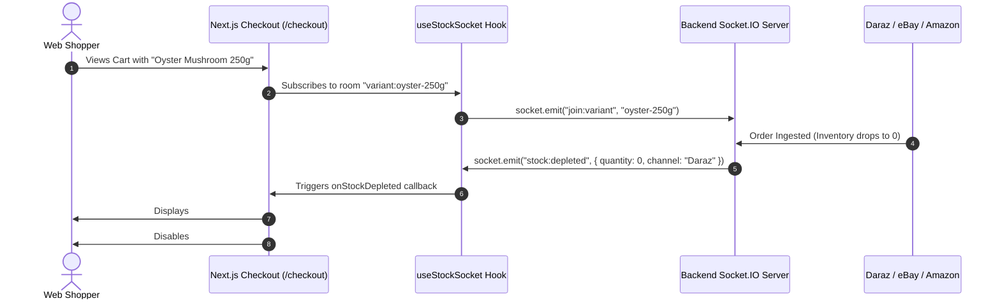

# MASKY Product — Frontend (Storefront & Admin Control Center)

> High-performance Next.js 15 App Router web application powering **MASKY Product**, a multi-channel direct-to-consumer and B2B e-commerce platform specializing in premium **dehydrated mushroom products** (Oyster, Shiitake, Lion's Mane, King Oyster, Button mushrooms, organic gourmet seasoning, and culinary extracts). Featuring bidirectional **real-time WebSocket inventory synchronization** across **Daraz Sri Lanka**, **eBay Marketplace**, **Amazon Seller Central (SP-API)**, and the **Web Storefront** to eliminate overselling and prevent 0-stock checkouts.

---

## 🍄 About MASKY Product

**MASKY Product** delivers farm-fresh, premium-grade dehydrated mushroom varieties and functional fungi superfoods. Our dehydration and packaging process preserves maximum nutritional bio-actives, umami concentration, and provides extended shelf-stability for gourmet kitchens, health enthusiasts, and commercial food services.

To power this omnichannel enterprise, this frontend application delivers:
1. **Customer Web Storefront**: A fast, responsive, and intuitive shopping experience optimized for dehydrated mushroom product discovery, bundle selections, recipe pairing guides, and seamless checkout.
2. **Multi-Channel Admin Control Center**: A centralized command portal (`/admin/channels`) providing real-time visibility into stock allocations, order ingestion, catalog publishing, and sync health across **Daraz**, **eBay**, and **Amazon**.
3. **Real-Time WebSocket Stock Guard**: Instant reactive lockout that disables checkout the exact millisecond an item sells out on any connected channel.

---

## ⚡ Tech Stack

| Technology | Purpose |
| :--- | :--- |
| **Next.js 15 (App Router)** | React framework with Server Components, streaming SSR, and route handlers |
| **React 19** | Modern UI library with hooks, concurrent rendering, and transitions |
| **TypeScript** | Strict compile-time typing across all services, props, and schemas |
| **Tailwind CSS v4** | Modern utility-first styling with custom semantic theme tokens |
| **Socket.IO Client v4** | Bidirectional WebSocket communication for real-time stock sync |
| **TanStack React Query v5**| Client-side server state management, caching, and optimistic mutations |
| **Zustand** | Lightweight client state for cart sessions, sidebar state, and dialogs |
| **React Hook Form + Zod** | Form validation, checkout schema enforcement, and address parsing |
| **Lucide React** | Clean, consistent SVG iconography |
| **Playwright** | End-to-end automated testing with headless Chromium execution |

---

## 🌟 Key Features

### 1. Storefront Experience (`/`, `/shop`, `/products/[slug]`, `/checkout`)
- **Product Catalog**: Filter dehydrated mushrooms by culinary category (*Whole Dried Mushrooms*, *Sliced*, *Organic Powders*, *Gourmet Mushroom Blends*, *Medicinal Extracts*).
- **Product Details**:
  - Detailed rehydration guides, moisture retention stats, culinary recipes, and shelf-life indicators.
  - Multi-pack weight options (50g, 100g, 250g, 500g, 1kg pouches).
  - **Live WebSocket Stock Display**: Reactive stock pills (`In Stock`, `Low Stock`, `Out of Stock`) that react without page reload.
- **Cart & Split-Column Checkout**:
  - **Real-Time Sync Active Badge** (`#realtime-sync-indicator`) indicating live socket connectivity.
  - **Zero-Stock Reactive Banner** (`#realtime-stock-alert`): Alerts the shopper if a cart item was just purchased on Daraz, eBay, or Amazon.
  - **Instant Checkout Lockout**: Disables `#place-order-submit-btn` and marks affected line items with *"Out of Stock (Depleted on another channel)"*.
  - **Atomic Pre-Flight Guard**: Calls backend stock verification before payment initiation to guarantee inventory integrity.
  - **Payment Gateways**: Cash on Delivery (COD), Koko (BNPL installments), and PayHere Credit/Debit Card.

### 2. Multi-Channel Control Center (`/admin/channels`)
- **Socket Gateway Status**: Live pulsating status indicator (`#websocket-status-badge`) indicating WebSocket link to backend socket server.
- **Omnichannel Channel Cards**:
  - **Daraz Sri Lanka & Regional**: Sync status, active SKU listings, automated price/order syncing.
  - **eBay Marketplace**: Cross-border international listings (`EBAY_US`), global currency conversion.
  - **Amazon Seller Central (SP-API)**: Prime & merchant-fulfilled inventory health and automated listing synchronization.
  - **Web Storefront**: Direct primary channel allocation.
- **Real-Time Audit Stream**:
  - Live activity table dynamically prepending sync events (`REALTIME_0_STOCK_GUARD`, `INVENTORY_SYNC`, `ORDER_INGESTED`).
  - Channel credential configuration modals for API keys, app secrets, and sync interval rules.

### 3. Comprehensive Admin Operations Portal (`/admin`)
- **Analytics & BI**: Multi-channel gross revenue, orders, active cross-listings, and gateway sync latency.
- **Inventory Management**: Multi-SKU stock tracking, batch numbers, drying dates, and low-stock alerts.
- **Order Pipeline**: Unified cross-channel order queue with status workflow (Pending, Processing, Dispatched, Delivered).
- **Media Library & CMS**: Visual asset manager for dehydrated mushroom packaging shots, nutrition banners, and homepage slides.
- **Granular RBAC**: 57 granular permissions supporting Super Admin, Inventory Manager, and Fulfillment Staff roles.

### 4. Adaptive Design System & Dark Theme
- **Theme Support**: Seamless dark and light modes powered by semantic CSS variables (`bg-surface`, `border-border`, `text-foreground`).
- **Collapsible Sidebar**: Unified navigation with a 1-click collapse button on the top header, transforming into an icon rail menu.
- **Theme-Follow Scrollbars**: Custom scrollbar styling that adapts automatically to active dark/light theme tokens.

---

## 📂 Project Architecture

```
Frontend/
├── app/
│   ├── (storefront)/              # Public customer-facing pages
│   │   ├── page.tsx               # Homepage hero, featured dehydrated mushrooms, benefits
│   │   ├── shop/                  # Filterable mushroom catalog
│   │   ├── products/[slug]/       # Product details & live stock selector
│   │   ├── cart/                  # Shopping cart view
│   │   ├── checkout/              # Checkout flow with real-time 0-stock lockout
│   │   └── account/               # Customer profile, orders, addresses, wishlist
│   ├── admin/                     # Back-office operations & control center
│   │   ├── layout.tsx             # Collapsible sidebar layout with icon rail
│   │   ├── page.tsx               # Multi-channel dashboard overview & KPIs
│   │   ├── channels/              # Multi-Channel Control Center (Daraz, eBay, Amazon)
│   │   ├── inventory/             # Stock adjustments & batch management
│   │   ├── orders/                # Cross-channel order fulfillment
│   │   └── products/              # Mushroom catalog & SKU variant manager
│   ├── layout.tsx                 # Root layout with theme provider & fonts
│   └── globals.css                # Tailwind design system & theme tokens
├── components/
│   ├── dashboard/                 # Admin header, sidebar, KPI stat cards, charts
│   ├── ui/                        # Reusable accessible UI primitives (dialogs, buttons, pills)
│   └── storefront/                # Product cards, banners, rehydration guides, cart drawer
├── hooks/
│   ├── useStockSocket.ts          # Reactive WebSocket hook subscribing to variant & admin rooms
│   ├── useChannels.ts             # React Query hooks for channel configs and logs
│   ├── useCart.ts                 # Cart mutations and session state
│   └── useCheckout.ts             # Atomic checkout initiation
├── services/
│   ├── socket.client.ts           # Singleton Socket.IO client with event dispatching
│   ├── channel.service.ts         # REST client for multi-channel endpoints
│   ├── checkout.service.ts        # Atomic verify-stock and order placement API
│   ├── cart.service.ts            # Cart management API
│   └── api.ts                     # Axios instance with CSRF interceptors & base URLs
└── tests/
    ├── realtime-stock-websocket.spec.ts  # Playwright E2E real-time stock sync & lockout tests
    ├── dark-theme-audit.spec.ts          # Automated theme visual regression tests
    └── screenshots/                      # Verified visual proof artifacts
```

---

## 🔌 Real-Time WebSocket Architecture



---

## 🚀 Getting Started

### Prerequisites
- **Node.js**: v20.x or v22.x
- **npm** or **pnpm**
- **Running MASKY Backend**: API server running on `http://127.0.0.1:5000`

### Installation
```bash
# Navigate to the frontend directory
cd Frontend

# Install dependencies
npm install
```

### Environment Configuration
Create or edit `.env.local`:
```env
# Backend API & Socket Gateway
NEXT_PUBLIC_API_URL="http://127.0.0.1:5000/api/v1"
NEXT_PUBLIC_SOCKET_URL="http://127.0.0.1:5000"

# Cloudflare Turnstile bot protection
NEXT_PUBLIC_TURNSTILE_SITE_KEY="1x00000000000000000000AA"

# Feature toggles
NEXT_PUBLIC_ENABLE_POS="false"
NEXT_PUBLIC_ENABLE_MULTI_BRANCH="false"
```

### Running Locally
```bash
# Start Next.js development server
npm run dev

# Open in browser:
# Storefront: http://localhost:3000
# Admin Control Center: http://localhost:3000/admin/channels
```

### Production Build
```bash
# Run type checking
npx tsc --noEmit

# Compile production bundle
npm run build

# Start production server
npm start
```

---

## 🧪 Automated Testing (Playwright)

The frontend includes end-to-end tests validating the real-time stock sync engine and 0-stock checkout lockout:

```bash
# Run real-time WebSocket stock sync & zero-stock guard tests
npx playwright test tests/realtime-stock-websocket.spec.ts --project=chromium

# Run full admin dashboard suite
npx playwright test tests/dashboard-complete.spec.ts --project=chromium

# Run dark/light theme audit
npx playwright test tests/dark-theme-audit.spec.ts --project=chromium
```

---

## 📄 License
Proprietary & Confidential — **MASKY Product** © 2026. All rights reserved.
